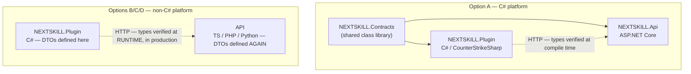

# 004 — Web platform language & stack

**Status:** **decided**
**Date:** 2026-08-10
**Lens applied:** architecture-designer
**Decision:** **ASP.NET Core** backend + **TypeScript** frontend, types generated via NSwag.
Conditional on the silent-failure mode being engineered away — see
[035](035-match-result-integrity.md).

---

## Context

The NEXTSKILL web platform must be written from scratch ([003](003-build-basis.md)).
Two languages are already locked and non-negotiable:

| Language | Why locked | Decision |
| --- | --- | --- |
| **C# / .NET 8** | CounterStrikeSharp is the only viable CS2 server modding framework | [002](002-cs2-plugin.md) |
| **Pawn / Small** | AMXX is the only CS 1.6 modding framework | [001](001-game-scope.md) |

The question is only: **what language runs the web platform**, and does it add a third or
a fourth language to the project.

Additional stated requirement: *"if the project succeeds we would love to make it scalable."*

---

## Non-functional requirements — the load profile that actually matters

Framework throughput comparisons are meaningless without knowing what the system does.
NEXTSKILL's load is **not** uniform request/response:

| Workload | Shape | Volume | Difficulty |
| --- | --- | --- | --- |
| Match config pull | One request per match start | Trivial | none |
| Game server event webhooks | Bursty, ~1 per round per live match | 10 concurrent matches ≈ a few req/s | none |
| **Live spectating** | **Long-lived push connections** (bracket, scoreboard, veto) | **Thousands of concurrent connections during a popular final** | **the real one** |
| **Demo ingest** | Large file upload, long-lived request | CS2 demos are large; one per map per match | **I/O + storage, not CPU** |
| **Rating / ELO recalculation** | CPU-bound batch over match history | Grows with every match played forever | **CPU-bound** |
| Profile / bracket browsing | Read-heavy, highly cacheable | Spiky around events | easy (cache) |

Three of these — **long-lived connections, background CPU work, large file ingest** — are
exactly where the four candidates genuinely differ. Plain request/response throughput is
where they differ least in practice.

---

## Evidence: synthetic throughput

[TechEmpower Round 23](https://www.techempower.com/benchmarks/) (Feb 2025), *Fortunes*
test — the most realistic of their tests (DB query + template render):

| Framework | RPS | Relative |
| --- | --- | --- |
| **ASP.NET Core** | 609,966 | **36.3×** |
| Go Fiber | 338,096 | 20.1× |
| Rust Actix | 320,144 | 19.1× |
| Java Spring | 243,639 | 14.5× |
| **Node.js Express** | 78,136 | **4.7×** |
| Rails | 42,546 | 2.5× |
| **Django** | 32,651 | **1.9×** |
| **PHP Laravel** | 16,800 | **1.0× (baseline)** |

FastAPI sits between the compiled leaders and the older sync frameworks.

**Read this honestly.** These are synthetic framework-overhead tests. In production the
database and network are almost always the bottleneck, and every framework here is
enormously faster than a community CS tournament site will ever need. A 36× ratio on a
workload that never exceeds 100 RPS is worth **nothing**.

The numbers matter for exactly one thing: they show ASP.NET Core has *headroom to waste*,
which reduces how carefully we must think about performance. That is a real, if modest,
benefit.

---

## What actually separates the four

### The decisive factor: contract sharing with the plugin

The plugin↔panel wire contract is the highest-risk interface in the system. It is our own
design ([002](002-cs2-plugin.md)), it carries match results, and a silent mismatch corrupts
tournament data.



With a C# platform, the DTOs are a single compiled library referenced by both sides. A
payload mismatch is a **build error**. With any other platform the contract is duplicated
by hand and drift is discovered when a real match reports a wrong score.

This is mitigable elsewhere (generate types from an OpenAPI schema), but it is *free* in C#.

### Long-lived connections & background work

| | ASP.NET Core | Node / TS | PHP | FastAPI |
| --- | --- | --- | --- | --- |
| Live push | **SignalR** (WS + fallbacks) built in | ws / Socket.IO | **Not native** — needs Swoole/ReactPHP or a separate service | Native WS support |
| Background jobs | **`BackgroundService`** in-process | Fine, but shares the event loop | **Not native** — needs queue + separate workers | Fine, but shares the loop |
| CPU-bound recalc | **True multithreading** | Blocks the loop; needs worker threads | Separate workers | **GIL-limited**; needs processes |
| Large file ingest | Streams natively | Streams natively | Needs upload limit tuning | Streams natively |
| Extra components needed | **none** | none | **WS service + queue + workers** | none |

PHP's request-per-process model is the standout problem. Everything NEXTSKILL needs
beyond plain page serving — live brackets, rating recalculation, match-state timers —
requires bolting on components PHP does not provide natively. That is a scalability cost
paid in **operational pieces**, not in requests per second.

### Scaling out, if it succeeds

Worth stating plainly: **scalability comes from statelessness, one database, and a cache —
not from the language.** All four scale horizontally behind a load balancer.

The language determines how many moving parts that requires. For the live-connection tier
specifically, [SignalR scales out via a Redis backplane](https://learn.microsoft.com/en-us/aspnet/core/signalr/redis-backplane),
with two documented caveats worth recording now:

- sticky sessions are still needed **unless** clients are WebSocket-only with
  `SkipNegotiation` enabled
- **SignalR does not buffer messages when Redis is unavailable — messages sent during a
  Redis outage are silently lost.** Live scores are not durable state; the database is.
  The UI must be able to recover by re-fetching, never by trusting it saw every event.

Socket.IO has an equivalent Redis adapter with equivalent caveats. Neither is a
differentiator; both work.

---

## Comparison summary

| Criterion | ASP.NET Core | Node / TS | PHP | FastAPI |
| --- | --- | --- | --- | --- |
| Total languages in project | **3** | 3 | **4** | **4** |
| Shares code with CS2 plugin | **Yes — compiled DTOs** | No | No | No |
| Contract drift caught at | **Compile time** | Runtime (or codegen) | Runtime | Runtime |
| Synthetic throughput | **36.3×** | 4.7× | 1.0× | ~2–4× |
| Live push | SignalR, built in | Socket.IO | **Bolt-on required** | Built in |
| Background jobs | In-process | In-process | **Separate workers required** | In-process |
| CPU-bound rating recalc | **True threads** | Worker threads | Separate workers | **GIL-limited** |
| Frontend language | TS (separate) | **TS (same)** | JS (separate) | TS (separate) |
| Web ecosystem size | Good | **Largest** | Large | Large |
| Existing operator experience | Low | Low | **High (FragHub)** | Low |
| Learning value (stated goal) | **High — deepens C# already required** | High | Low — already known | High |
| Hosting cost | Low | Low | **Lowest** | Low |

---

## Head-to-head: ASP.NET Core vs Node/TypeScript

PHP and FastAPI eliminated. This is the real decision, and it is genuinely close.

### Demo parsing is a wash

Both ecosystems have a strong CS2 parser, so this cannot decide it:

| | Library | Approach | Performance |
| --- | --- | --- | --- |
| C# | [DemoFile.Net](https://github.com/saul/demofile-net) (NuGet `DemoFile`, v0.37.x) | Event-driven + streaming | Full competitive game in **1.3s**; ~**500ms** with `ReadAllParallelAsync` |
| JS | [demoparser](https://github.com/LaihoE/demoparser) | Query-the-demo-like-a-database | Rust core, bindings for JS and Python |

### The argument against my own recommendation

I claimed compile-time contract safety with the plugin as the decisive C# advantage.
The honest counter is about **which contract is exercised more**:

| Contract | Endpoints | Change frequency | Failure mode |
| --- | --- | --- | --- |
| Plugin ↔ Panel | ~10 | Rarely, once stable | **Silent** — wrong score recorded during a live final |
| Panel ↔ Frontend | Dozens, growing forever | Constantly | **Loud** — page breaks immediately in dev |

TypeScript gives you type safety across the **larger, faster-changing** surface.
C# gives it across the **smaller, more dangerous** one.

**And both weaknesses are fixable by the same tool.** OpenAPI codegen runs in either
direction — a TS panel can generate a typed C# client for the plugin; a C# panel can
generate TS types for the frontend (NSwag is mature at this). So neither language has a
structural monopoly on type safety; each just gets one seam for free and pays for the other.

That reduces the decision to three things that codegen cannot fix:

1. **Language count and depth.** C# is mandatory for the CS2 plugin regardless. Choosing
   ASP.NET Core means going deep in a language already required. Choosing Node means
   maintaining real competence in both, permanently.
2. **CPU-bound rating recalculation.** C# has true multithreading; Node needs worker
   threads. Real, but small at community-scene data volumes — and honestly not decisive
   until the match history is large.
3. **Ecosystem and examples.** Node is meaningfully larger, with far more prior art for
   "web app with live updates and brackets."

### Verdict

| If you value... | Choose |
| --- | --- |
| One language across game server *and* backend; deepest learning; most headroom | **ASP.NET Core** |
| One language across backend *and* frontend; largest ecosystem; fastest day-to-day iteration | **Node / TypeScript** |

Both are defensible. There is no wrong answer here, only a preference about **which seam
you want to be free** — the game-server seam or the frontend seam.

---

## Recommendation

**ASP.NET Core**, for three reasons in priority order:

1. **It does not add a language.** C# is already mandatory for the CS2 plugin. Options C
   and D make NEXTSKILL a four-language project for no structural gain.
2. **The riskiest interface becomes compile-time safe** — plugin and panel share one DTO
   library.
3. **It needs no extra components** for live connections, background jobs, or CPU-bound
   rating work — the three things this project actually does beyond serving pages.

The stated learning goal is *better* served by going deep in one language used at both the
game-server and web layers than by spreading across four.

**The honest counter-argument for Node/TypeScript:** one language for API *and* frontend
(C# still needs a separate TS frontend), the largest ecosystem, and the most community
examples for exactly this kind of site. It is a legitimate choice — it simply trades
compile-time contract safety for frontend-language unity.

**PHP and FastAPI are not recommended here.** Both add a fourth language and share nothing
with the plugin. PHP additionally requires bolt-on infrastructure for the workloads that
define this product.

---

## Consequences if ASP.NET Core is chosen

- **Positive:** shared contracts; no extra infra for push/jobs; large performance headroom;
  one ecosystem to learn deeply; EF Core, DI, auth, health checks, config all built in.
- **Negative:** frontend is still a separate language (TS); smaller pool of
  "tournament site in C#" examples to learn from; Windows-hosting instinct must be resisted
  — deploy on Linux containers.
- **Risk:** using `Contracts` as a dumping ground couples plugin and panel too tightly.
  It must contain **wire DTOs only** — no business logic, no database entities.

## Decision

**ASP.NET Core for the API and platform. TypeScript for the frontend.**

```
NEXTSKILL.Contracts   (wire DTOs only — no logic, no DB entities)
   ├── NEXTSKILL.Plugin   C# / CounterStrikeSharp   (CS2)
   └── NEXTSKILL.Api      ASP.NET Core
          └── NSwag ──► generated TS types ──► frontend (TypeScript)

NEXTSKILL.Plugin16       Pawn / AMXX               (CS 1.6)
```

Languages: **Pawn + C# + TypeScript = 3.** No language added beyond what the game plugins
already force.

Both seams are typed: the plugin seam by a shared compiled library, the frontend seam by
NSwag code generation.

### Condition attached to this decision

The head-to-head identified that the plugin↔panel seam fails **silently** — a wrong score
recorded during a live final, with nothing visibly broken. A shared DTO library catches
*shape* drift but **not semantic error**: a correctly-shaped payload carrying a wrong score
compiles fine.

Type safety is therefore necessary but not sufficient. This decision is accepted on the
condition that result integrity is engineered explicitly, per
**[035 — Match result integrity](035-match-result-integrity.md)**.
