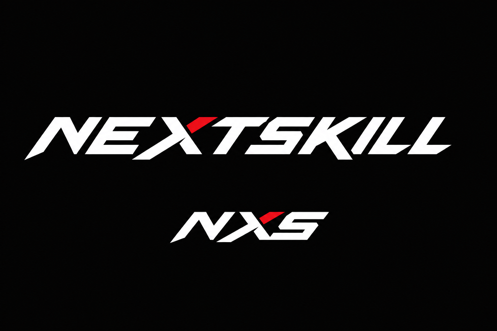

# 044 - Visual direction: Quiet Competitive Utility

**Status:** DIRECTION DECIDED - monochrome prototyping, measured validation, exact colour values,
and production logo assets remain before closure
**Date opened:** 2026-08-11
**Direction grilled:** 2026-08-23
**Blocks:** final colour tokens and a production-ready brand asset package
**Relates to:** [019](019-visual-identity.md), [020](020-motion-and-ux.md),
[021](021-site-structure.md), [041](041-layout-system.md), [043](043-page-contents.md),
[050](050-match-results-and-ratings.md), [056](056-lft-board.md),
[057](057-server-browser-and-seo.md)

---

## Decision in one sentence

NEXTSKILL uses a dark, quiet, professional, content-first interface whose quality comes from
information hierarchy, alignment, spacing, and fast task completion; competitive aggression is
concentrated in the wordmark, not spread across the product UI.

The name for this direction is **Quiet Competitive Utility**.

## Why

NEXTSKILL is a record of results and a tool the scene runs on. Most visits land on content-heavy
pages, where trust is earned by making facts easy to locate and actions hard to misunderstand.
Loud identity ages quickly and adds another styling decision to every future page. A raw gray
table, however, is not automatically professional. The target is the band between those two
failures: **not overstyled and not underdesigned**.

CYBERSHOKE and FACEIT are composition references, not skins to copy. CYBERSHOKE demonstrates how
many modes can be exposed through clear labels and live counts; FACEIT demonstrates a composed
logged-out introduction. Their value here is organisation. Decision 019's prohibition still
holds: NEXTSKILL must not become FACEIT's dark UI plus saturated orange, or use accents close to
`#FF5500`.

## What this explicitly rejects

- Poster School, neo-brutalist blocks, and ornamental asymmetry.
- Tactical HUD styling: corner brackets, amber readouts, radar frames, or mono body copy.
- Generic gamer typography such as Russo One, Orbitron, Chakra Petch, or similar esports faces.
- Neon, glow, glass, decorative gradients, clipped corners, chrome, bevels, and fake depth.
- Card mosaics, nested cards, badge soup, and an icon in every column.
- Decorative weapons, maps, smoke, screenshots, or AI-generated game art.
- Page-specific visual identities and a supposedly memorable signature component.
- Retro styling and frictionless-looking "AI slop" modernism.

## Composition is the product quality

Composition is measured by scan time and actions-to-task, not by taste. Every hard screen is
designed in monochrome first. Colour may clarify an already-working hierarchy; it may not create
the hierarchy.

The default evaluator is a **domain-literate first-time NEXTSKILL user**. They understand terms
such as veto, scrim, LFT, ping, and rating, but do not yet know where NEXTSKILL places things.
Experts gain speed from stable positions, useful defaults, preserved filters, and keyboard
support - not hidden controls or compressed rows.

### Composition acceptance criteria

Every screen receives task-specific criteria before styling approval. The common floor is:

1. Within **5 seconds**, a user can state the page purpose, current state, and dominant next action.
2. Within **10 seconds**, a user can locate a named entity in a typical populated view.
3. Starting from the relevant list, the primary task begins within **two navigation actions**.
4. Each decision point exposes only **one primary action**.
5. Entering required data, choosing required values, and a safety confirmation do not count as
   navigation actions.
6. Returning from a detail view preserves filters, sort, and scroll position.
7. Tests use realistic Polish content, long multilingual strings, and realistic data volume.

### Prototype and validation matrix

The acceptance suite is larger than three attractive mockups:

| Screen | Typical case | Stress case | Primary test |
| --- | --- | --- | --- |
| Bracket | 16-team double elimination | 128 teams | Find a team, its completed route, current match, and next match |
| Match | Scheduled, veto, live, completed | Disputed | Understand state and the one role-relevant action |
| Organiser queue | Healthy event, a few urgent items | About 50 mixed items | Find the highest-consequence work first |
| Veto | Before and mid-veto | Timeout and completed history | Identify whose turn, legal choices, timer, and prior actions |
| Scrims | Typical open slots | Empty, expired, and long notes | Find a viable slot and propose or accept it |
| LFT / LFP | Typical recruitment | Long multilingual content and 100+ rows | Find a fit without mixing the two intents |
| Tournament finder | Open registration | Check-in, live, and finished | Find an eligible event and act |
| Server list | Populated live list | Long names, stale data, and offline history | Answer "Can I play now?" |
| Player directory | Typical search | Provisional and unrated players | Find a person without implying rank |
| Rankings | Global and per-server | Provisional, tied, and stale source data | Compare performance with source and uncertainty intact |

Each list is also checked empty, filtered-to-zero, logged out, authenticated, desktop, and mobile.
At least three domain-literate first-time testers are used, including a player or captain and an
organiser or admin. Record first click, path, hesitation, and state comprehension. Repeated
confusion is a design defect. Accessibility checks are separate, not inferred from task success.

## Foundation

### Theme and colour roles

Launch is **dark only**. Semantic tokens must make a future light theme possible, but no light
theme is designed or promised now.

The palette family is **black, red, white, and gray**. Exact values stay deliberately open until
the monochrome prototypes pass.

| Role | Use |
| --- | --- |
| Near-black / charcoal | Ground and base surfaces; avoid pure-black glare |
| White / off-white | Primary text and strongest neutral action contrast |
| Deliberate grays | Secondary text, borders, disabled state, and surface separation |
| Red | Sparse signal accent: logo detail, live, urgent, error, and destructive states |

Red is not the colour of every link or routine primary button. Routine actions use neutral
black/white contrast. CT and T colours may appear only where side identity has real domain
meaning, and never become platform brand accents. Colour never carries meaning alone.

### Surfaces and containers

There are three surface levels: ground, surface, and raised/interactive. Thin neutral borders do
most of the separating. Shadows are reserved for menus and dialogs.

Containers are chosen by purpose:

- tables or aligned rows for comparison;
- plain sections and dividers for continuous records;
- cards only for genuinely independent objects.

No universal "rows not cards" dogma is needed; the information relationship decides the
container. Nested cards and decorative tile grids are not allowed.

### Typography

- **Inter Variable**, self-hosted with Latin Extended and Cyrillic subsets, is the UI, body, and
  heading family.
- Data uses tabular numerals from the same family.
- Monospace is limited to actual code, tokens, and technical IDs.
- There is no separate display or gamer face in the interface.

### Density and width

Density is compact but never cramped:

- Public rows are approximately **48px** high.
- Dense organiser and admin rows are at least **40px** high on desktop.
- Interactive touch targets are at least **44px**.
- Content expands naturally when a critical string must wrap.
- There is no user-facing density toggle.

Comparison-heavy public screens may use a **1200px** content width with deliberate columns.
Focused prose and detail pages stay around **1080px** or narrower. Panels remain fluid up to
1440px. Only the bracket receives a full-width canvas.

### Geometry

- Controls and buttons: 6px radius.
- Independent panels, menus, and dialogs: 8px radius.
- Tables, lists, and page sections: square unless containment genuinely needs a radius.
- Fully rounded pills: statuses and removable filters only.
- Ordinary surfaces do not exceed 8px and never use clipped tactical corners.

### Shared row grammar

Lists use the same reading order:

**Identity -> decision facts -> current state -> next action**

On mobile this becomes top-to-bottom rather than a squeezed desktop table. Each row retains
identity, two or three critical facts, state, and action. Secondary information moves to a second
line or disclosure. Ordinary lists never require horizontal scrolling.

The row or name opens detail. There is one visible inline primary action; secondary actions move
to detail or a menu. Essential actions never exist only on hover, and destructive actions remain
visually separate.

### Filters and headers

List filters expose search plus the two most-used filters. Less common filters live under
**More filters**. Active filters remain visible and individually removable, with counts only when
they help a decision. State lives in the URL. Desktop uses a compact bar; mobile uses a focused
drawer. Changing one filter must not reset unrelated choices or position.

Page headers normally contain an H1, essential scope or state, an optional single explanatory
sentence, and one consistently placed primary action. A breadcrumb appears only where hierarchy
is unclear. Decorative eyebrows are removed; an eyebrow is permitted only when it conveys useful
tournament stage or organiser scope.

### Status, icons, imagery, and charts

- Status pills are reserved for fast-scanned states such as live, open, full, disputed, offline,
  and verified. Prefer one per row; allow two only for separate essential facts.
- Use one restrained outline icon set. Important or unfamiliar actions retain text labels. No
  decorative tactical, weapon, skull, military, mixed-style, or emoji iconography.
- Team logos, player avatars, organiser marks, maps, and sponsor marks appear only when they aid
  identification. Lists use small consistent images; detail pages may use larger ones. Every slot
  has a neutral fallback.
- Charts exist only when change over time or a distribution matters, such as occupancy or rating
  history. They use direct labels, neutral gray, and red only for a meaningful selection or alert.
  No 3D, radial decoration, gradients, or decorative sparklines. The underlying value remains
  available as text or a table.

### Motion and accessibility

Motion is functional and normally **120-180ms**: state changes, opening or closing, reordering,
and live updates. A changed live value may highlight briefly without moving the layout. No page
entrances, parallax, animated backgrounds, or decorative pulsing. Reduced motion is honoured.

WCAG 2.2 AA is the floor: 4.5:1 for normal text, 3:1 for large text and meaningful boundaries,
visible keyboard focus, colour redundancy, 44px touch targets, semantic tables/headings/labels,
appropriate live regions, and no two-dimensional page scrolling at 200% zoom except the
controlled bracket canvas.

Strings must tolerate roughly 30% expansion and Polish, German, Russian, and English content.
Critical identities and actions wrap rather than silently clip. Secondary text may truncate only
when the full value is available without relying on a hover tooltip.

## Hard-screen information contracts

### Bracket

Desktop keeps the full tree. A persistent **Find team** control jumps to and highlights the
team's completed route, current match, and next match while dimming unrelated connectors. Round
labels remain sticky and reset is obvious. Mobile is round-by-round with follow-team navigation.

A node shows team identity, optional small logo, seed when useful, score or scheduled time, and
one essential state such as live, disputed, forfeit, bye, or awaiting. Winner state uses weight,
position, and text rather than colour alone. The whole node opens match detail. Server, veto,
rating, and internal IDs do not belong in the node. An unresolved slot names its source, such as
"Winner of M12".

### Match

The top always shows teams, score or time, tournament, and state. A captain sees the one required
action; an organiser sees intervention only when relevant; a spectator sees the outcome and what
happens next. Disabled admin controls do not clutter public or captain views.

Veto, maps, lineups, server, integrity, and history are ordered according to state. Scheduled,
live, disputed, and completed views share one URL and one visual grammar.

### Organiser operations

The landing page is an operations queue, not a dashboard of cards and vanity charts. Work is
ordered by consequence and deadline. Each item shows the affected object, the problem in plain
language, why it matters, who or what is waiting, the deadline, and one action. Healthy state is
quiet; history lives elsewhere.

Disputes and other high-consequence decisions open a dedicated case page containing result and
teams, integrity evidence separated from captain claims, timeline, evidence, consequences, and a
separated decision with reason. Returning restores queue state.

### Veto

Hierarchy is current turn, responsible team, required action, then timer. Legal choices form a
uniform map grid with restrained thumbnails and names. Completed choices become a chronological
record. Readiness and organiser intervention sit below. Unavailable maps move into history rather
than remaining as a noisy crossed-out field. Spectators see no controls. Veto earns memorability
through clarity, not a signature graphic strip.

### Scrims

The primary object is an **available match slot**, not a social post. A row shows local date and
time, game and format, team, rating and uncertainty, server region or availability, state, and one
propose/accept action. A note is secondary. Default order is the soonest viable slot; expired and
filled slots leave the active view.

### LFT and LFP

Recruitment is one area with two explicit, stable-URL views: **Looking for team (LFT)** and
**Looking for player (LFP)**. They are never mixed in one result list. Shared game switching,
filters, logged-out introduction, and private workspace keep the area coherent.

Rows show identity, verified rating and match count, primary role or roster slot, concise
availability or schedule overlap, region, freshness, and one action. Secondary roles, languages,
full schedule, form, and roster context move to expansion or detail. An optional 300-character
plain-text description may appear as a two-line excerpt; links remain inert there.

### Tournament finder

Group events by lifecycle: registration open; starting/check-in; live; finished history. Rows
show identity, organiser, game, format, schedule, deadline, slots, eligibility, and one action.

### Server list

The row answers **Can I play now?** with name and mode, verified human count or explicitly
qualified reported count, capacity, current map, region or latency, confidence/provenance, and a
connect action. Live human occupancy drives the organic order. Offline and historical views live
elsewhere. Paid placement is visually separate and labelled, and never alters reported numbers.

### Player directory and rankings

The player directory answers **Who is this person?** and **How do I find them?** It supports
factual filters and may include provisional or unrated players without implying rank.

The global ranking answers **Who is best under the published NEXTSKILL rules?** Its continuous
table shows rank, player, rating and uncertainty, matches, and form. There is no podium, crown,
medal, metal tier, flame, or top-three card. The top result may receive slightly stronger type.
Provisional entries remain separate and explained.

Per-server player leaderboards are additional views inside server detail, never replacements for
or inputs to global rating. A server metric must name its source, metric, period, and last update;
it must not be labelled "NEXTSKILL Rating". Different server metrics are not merged or compared.
If the plugin or an approved owner-authorised integration supplies insufficient data, no
leaderboard is shown. Player profiles may link to notable server placements with their source.

## Logged-out and organiser-brand treatment

Community servers, the player directory, and rankings are content-first and publicly readable.
There is no hero or login wall. Sign-in appears contextually only when a user attempts an action.

Tournaments, scrims, LFT, and LFP receive a compact section-specific logged-out introduction:
one heading, one short benefit paragraph, one signup action, a quiet login link, and no more than
three factual or live proof points. Real listings begin immediately and remain visible in the
first desktop viewport. No art, video, carousel, oversized slogan, or decorative background is
allowed. Authenticated users receive a utility header instead of the introduction.

Direct shared links always remain readable. Authentication returns the user to the original item
and final decision point with safe filter and referral state preserved; consequential actions are
never submitted automatically.

The platform shell, typography, layout, and actions remain NEXTSKILL's. An organiser may add a
logo, name, trust state, and restrained sponsor area, but cannot recolour or reskin a tournament.

## Rating labels surfaced by these screens

Every tournament and scrim declares **Rating affected** or **Rating not affected** before
participation. A rated label is necessary but not sufficient: the event also needs complete,
trusted data through the NEXTSKILL plugin or an approved owner-authorised integration carrying
identity, roster, result, and provenance. A tournament cannot change its label after registration
opens; a scrim cannot change after both sides accept. A feed failure produces a pending state or
an explicit audited unrated outcome, never a silent rating change.

This is a product rule surfaced during the visual grill and reopens the looser participant-declared
path in [050](050-match-results-and-ratings.md). Its persistence and calculation details must be
amended there before implementation.

Integrations are outbound from owner infrastructure: a NEXTSKILL plugin, an approved adapter that
sends the same versioned contract, or an optional signed periodic export for non-live leaderboard
data. NEXTSKILL does not request database credentials, SSH, RCON, or arbitrary endpoint polling.

## Logo system

The logo is deliberately simpler than the explorations that led here:

1. A custom uppercase **NEXTSKILL wordmark** is the primary logo and default wherever it fits.
2. A simple horizontal **NXS** is the compact mark for favicons, mobile constraints, and small
   social placements.
3. There is no separate pictorial emblem and no forced merged-letter monogram.

In unfamiliar or promotional contexts, use the full wordmark or pair it near NXS. NXS may stand
alone in constrained product contexts from launch; larger standalone use should grow only after
recognition exists. Both need one-colour and inverse variants.

The wordmark may carry the deliberately aggressive competitive signal: roughly 8-12 degrees of
forward lean, compressed proportions, disciplined diagonal cuts, and short terminals. Red should
occupy roughly 10-15% as one structural cut or plane, not as an effect. Each letter must remain
readable without red, and NEXTSKILL should be read unprompted at roughly 120-140px width. Long
speed lines, flames, chrome, bevels, outlines, and ornamental symbolism are rejected.

The image above is a **direction reference, not a shippable asset**. The selected lettering must
be optically redrawn as deterministic vector artwork, tested at favicon and wordmark sizes, and
exported as SVG/PNG before closure. Earlier generated standalone symbols and the rejected vector
study are intentionally not retained.

## Provisional supporting surfaces

Open Graph cards begin with a 1200x630 black/white/gray/red system: content first, small NEXTSKILL
branding, optional content imagery, neutral fallback, no game art, texture, gradient, or slogan,
and legibility at a Discord thumbnail size.

Empty states distinguish: nothing exists yet, filters returned nothing, and nothing needs
attention. Each uses a short heading, one sentence, and at most one action. No mascot, large
illustration, or confetti. These two surface designs remain provisional until prototyped.

## Maintenance rule

A new pattern must justify a task need and reuse potential while preserving the shared grammar,
density, geometry, colour, and accessibility rules. Unique composition is allowed where the task
requires it, notably bracket and veto. Unique decoration is not.

"Quiet" is not permission to leave a raw table. A professional screen still needs deliberate
widths and alignment, clear identity/fact/state/action hierarchy, spacing rhythm, all interaction
states, responsive priorities, helpful defaults, sorting and filtering, strong type, tabular
numerals, and useful content imagery.

## Exit criteria

The direction is decided, but this document closes only when:

- the monochrome prototype matrix passes the task criteria above;
- exact neutral and red tokens are selected with measured WCAG contrast;
- Inter subsets and page-weight impact are verified;
- production vector wordmark and NXS assets, including inverse and small-size exports, exist;
- Open Graph and empty-state compositions are validated;
- the rating-eligibility follow-up in 050 and per-server leaderboard data contract are reconciled.

Until then, implementation remains monochrome. This is validation work, not another search for a
visual theme.
